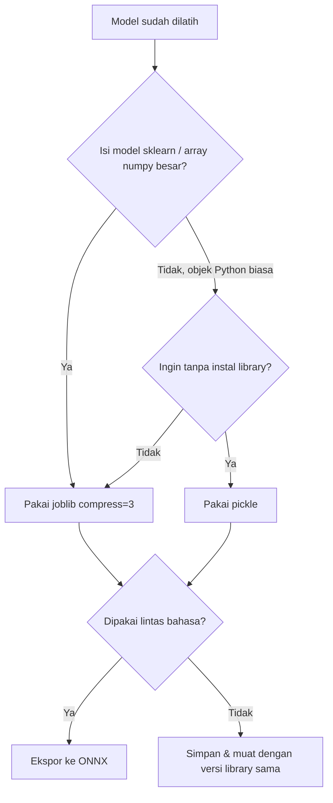

# Pertemuan 14 — Integrasi & Deployment Model (Joblib / Pickle)

Catatan dari materi dosen `Machine_Learning_and_Evaluation_Metric.md` bagian 6
("Menyimpan dan memuat model dengan joblib"). Pertemuan ini: **model yang udah
dilatih harus disimpan ke file biar bisa dipakai ulang tanpa training ulang**.

## 1. Kenapa joblib?

Model yang sudah dilatih harus **disimpan ke file** agar bisa dipakai ulang
tanpa melatih ulang. `joblib` menyimpan objek Python (termasuk pipeline
scikit-learn) ke file biner.

> [!IMPORTANT]
> Yang disimpan sebaiknya **SELURUH PIPELINE**, bukan cuma model. Dengan begitu
> imputer, scaler, dan encoder ikut tersimpan, dan input baru bisa langsung
> diberikan dalam **bentuk data mentah** (gak perlu preprocess manual).

## 2. Pola bundle (dictionary)

Satu file berisi dictionary (`bundle`) yang memuat pipeline + metadata yang
dibutuhkan aplikasi (mirip repo Fraud Detection):

```python
import joblib, sklearn

bundle_klasifikasi = {
    "pipeline": model,                          # preprocessing + classifier
    "fitur": FITUR_NUM + KOL_KAT,               # urutan kolom yang diharapkan
    "opsi": {c: sorted(df[c].dropna().unique().tolist()) for c in FITUR_NOM},
    "opsi_pendidikan": URUTAN_PENDIDIKAN,
    "threshold": 0.5,
    "versi_sklearn": sklearn.__version__,       # catat versi buat keamanan
}
joblib.dump(bundle_klasifikasi, "models/klasifikasi_siswa.joblib", compress=3)
```

Pola sama dipakai buat bundle regresi (`satuan_target`) dan klastering (`profil`).

## 3. Memuat & memprediksi

```python
bundle = joblib.load("models/klasifikasi_siswa.joblib")

# Input baru HARUS DataFrame dengan NAMA kolom yang sama seperti saat training
contoh = pd.DataFrame([{...}])[bundle["fitur"]]
proba = bundle["pipeline"].predict_proba(contoh)[0, 1]
label = "Lulus" if proba >= bundle["threshold"] else "Tidak Lulus"
```

## 4. Joblib vs Pickle

| Aspek | Joblib | Pickle |
|---|---|---|
| Asal | library pihak ketiga (`pip install joblib`) | modul **bawaan** Python |
| Model sklearn (banyak array numpy) | **lebih kecil & efisien** | lebih besar |
| Kompresi | bawaan lewat `compress=3` | manual (misal `gzip`) |
| Rekomendasi dokumentasi sklearn | **ya** | didukung, bukan pilihan utama |
| Objek Python biasa (dict/list) | didukung | didukung & lebih ringan |
| Keamanan | **sama-sama tak aman** dari sumber tak dipercaya | sama |
| Kompatibilitas | hanya Python | hanya Python |

Contoh nyata dari materi: Random Forest **534 KB** (pickle) vs **80 KB**
(joblib `compress=3`).

> [!TIP]
> **Pilih satu format per proyek** dan tetapkan di dokumentasi. Kalau model harus
> jalan di Java/JS/mobile → ekspor ke **format netral seperti ONNX**, jangan
> pakai joblib/pickle.



## 5. Aturan deploy aman

1. **Versi library harus sama** saat menyimpan & memuat (`scikit-learn`, `numpy`,
   `pandas`) — kunci di `requirements.txt` (`scikit-learn==1.9.1`).
2. **Input harus DataFrame dengan nama kolom yang sama** — pipeline mengenali
   kolom lewat **namanya**, bukan urutan posisi. Salah ketik → error di `predict`.
3. **Fungsi kustom harus bisa di-import, bukan lambda** —
   `FunctionTransformer(lambda x: np.log1p(x))` **gak bisa** disimpan joblib.
   Pakai `np.log1p` langsung.
4. **Jangan muat file `.joblib`/`.pkl` dari sumber tak dipercaya** — pickle bisa
   **menjalankan kode** saat dimuat.
5. **Model dengan data sensitif** jangan di-commit ke repo publik (pakai Git LFS
   atau penyimpanan terpisah).

## 6. Struktur folder proyek

```text
proyek-ml/
├── data/case9_student_performance.csv
├── models/
│   ├── klasifikasi_siswa.joblib
│   ├── regresi_housing.joblib
│   └── segmen_grosir.joblib
├── latih_klasifikasi.py
├── latih_regresi.py
├── latih_klastering.py
├── app.py
└── requirements.txt
```

```quiz
Q: Kenapa yang disimpan sebaiknya SELURUH pipeline, bukan cuma model?
+ Imputer/scaler/encoder ikut tersimpan → input baru bisa langsung data mentah, gak perlu preprocess manual
- Supaya file lebih kecil
- Karena model gak bisa disimpan sendiri
- Supaya training gak perlu diulang
> Tanpa preprocessing tersimpan, aplikasi harus replikasi manual preprocess → rawan beda hasil.

Q: Beda joblib dan pickle soal asal library?
+ Joblib = library pihak ketiga (pip install); pickle = modul bawaan Python
- Joblib bawaan, pickle pihak ketiga
- Dua-duanya bawaan Python
- Dua-duanya pihak ketiga
> Pickle gak butuh instal; joblib butuh tapi lebih efisien buat array numpy besar.

Q: Kenapa FunctionTransformer dengan lambda gak bisa disimpan joblib?
+ Lambda gak punya nama & gak bisa di-import — joblib butuh fungsi yang bisa di-import
- Karena lambda terlalu cepat
- Karena lambda pakai GPU
- Karena lambda bukan angka
> Solusinya: pakai np.log1p langsung atau fungsi yang didefinisikan di modul.

Q: Aturan keamanan paling penting saat memuat file .joblib?
+ Jangan muat dari sumber tak dipercaya — pickle bisa MENJALANKAN KODE saat dimuat
- Selalu pakai compress=3
- Simpan di folder models
- Kunci versi library
> Ini ancaman deserialisasi tak aman (arbitrary code execution).

Q: Kenapa versi library harus sama saat simpan dan muat?
+ Perbedaan versi bisa ubah perilaku objek → model gagal dimuat atau hasilnya beda
- Supaya hemat kuota
- Karena joblib minta begitu
- Biar file lebih kecil
> Kunci versi persis di requirements.txt (mis. scikit-learn==1.9.1).

Q: Pipeline mengenali kolom lewat apa?
+ Nama kolom (bukan urutan posisi)
- Urutan posisi kolom
- Index dataframe
- Tipe datanya
> Makanya input harus DataFrame dengan nama kolom sama — salah ketik → error di tahap predict.

Q: Kalau model harus dipakai di Java/JS, format apa yang dipakai?
+ Format netral seperti ONNX
- joblib
- pickle
- CSV
> joblib/pickle hanya Python; ONNX bisa dimuat runtime lintas bahasa.

Q: Contoh nyata di materi: ukuran file Random Forest joblib vs pickle?
+ 80 KB (joblib compress=3) vs 534 KB (pickle)
- 80 KB vs 534 KB kebalikannya
- Sama saja
- 1 MB vs 500 KB
> Joblib lebih efisien buat model sklearn yang banyak berisi array numpy.

Q: Model dengan data sensitif sebaiknya bagaimana?
+ Jangan di-commit ke repo publik — pakai Git LFS atau penyimpanan terpisah
- Selalu di-commit biar backup
- Simpan di folder data
- Ubah jadi teks
> File model bisa bocorkan info data latih; repo publik = siapa pun bisa unduh.

Q: Metadata apa yang ikut disimpan dalam bundle klasifikasi?
+ pipeline, daftar fitur, opsi kategori, threshold, versi sklearn
- Hanya akurasi
- Hanya nama file
- Hanya confusion matrix
- Hanya label
> Bundle = pipeline + semua yang dibutuhkan app buat rekonstruksi prediksi (fitur, opsi, threshold).
```