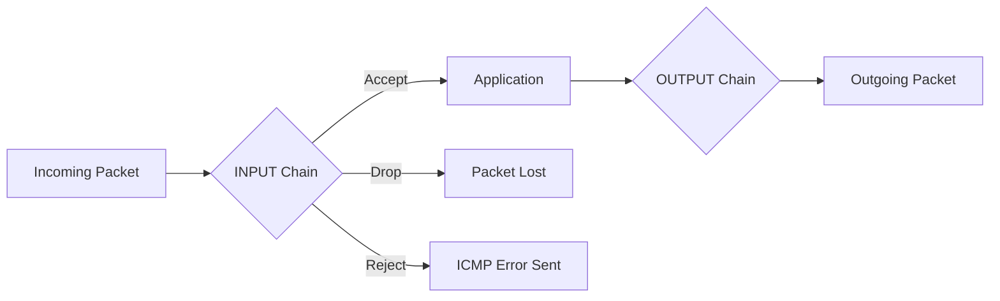

# Pertemuan 14 — Firewalling dengan iptables

Catatan ini aku susun dari materi dosen di `Network-Security-Course-Bank/Pertemuan14.md` (judul asli: "Pertemuan 14: Firewalling with iptables"). Lab-nya pakai container Ubuntu-target + Kali attacker di jaringan `172.20.0.0/24` yang sama kayak praktikum sebelumnya.

## Apa itu Firewall?

Firewall adalah pengawal keamanan jaringan yang memantau dan mengontrol lalu lintas jaringan masuk/keluar berdasarkan aturan keamanan yang ditentukan.

**Fungsi utama:**
- Membatasi akses ke layanan yang nggak perlu
- Mencegah serangan malware/scanning
- Mengatur segmentasi jaringan

## Mengenal iptables: Tables & Chains

Linux menggunakan framework **Netfilter** lewat utility `iptables`.

### Tables

| Table | Fungsi |
|---|---|
| **Filter** | Tabel default untuk filtering paket |
| **NAT** | Network Address Translation (routing) |
| **Mangle** | Modifikasi header paket |

### Chains (alur paket)

| Chain | Untuk paket apa |
|---|---|
| **INPUT** | Paket yang ditujukan ke server sendiri |
| **FORWARD** | Paket yang cuma lewat server (routing) |
| **OUTPUT** | Paket yang keluar dari server sendiri |

### Aksi di chain



> [!IMPORTANT]
> **DROP vs REJECT**: DROP = paket dibuang diam-diam (penyerang nggak tahu ada firewall, cuma timeout); REJECT = dibalas ICMP error (penyerang jadi tahu portnya ditolak). Dari sudut pandang keamanan, DROP lebih disukai biar informasi nggak bocor — ini bahan diskusi Latihan 2 di materi.

## Hands-On 1: Konfigurasi Dasar (Drop & Accept)

### Cek aturan saat ini (di container Ubuntu-target)

```bash
iptables -L -n -v
```

### Blokir ping (ICMP)

```bash
# Dari Kali: ping 172.20.0.10 (berhasil sebelum diblokir)
# Di Ubuntu-target:
iptables -A INPUT -p icmp -j DROP
# Cek lagi dari Kali → Request Timeout
```

### Hapus aturan

```bash
iptables -D INPUT 1     # hapus aturan di chain INPUT urutan ke-1
```

## Hands-On 2: Membatasi Akses Port Spesifik

Skenario: server cuma boleh diakses via HTTP (port 80), port lain ditutup.

```bash
# 1. Izinkan loopback (localhost)
iptables -A INPUT -i lo -j ACCEPT

# 2. Izinkan koneksi established/related (yang sudah berjalan)
iptables -A INPUT -m state --state ESTABLISHED,RELATED -j ACCEPT

# 3. Izinkan port 80 (HTTP)
iptables -A INPUT -p tcp --dport 80 -j ACCEPT

# 4. Blokir SEMUA yang lain (default policy)
iptables -P INPUT DROP
```

> [!WARN]
> Hati-hati jangan sampai memblokir **port SSH** kalau kamu pakai server remote! Aturan default policy `DROP` tanpa aturan `ACCEPT` untuk port 22 = kamu terkunci dari servermu sendiri. Urutan `lo` + `ESTABLISHED` di atas juga wajib biar koneksi yang sudah jalan nggak putus.

## Hands-On 3: Rate Limiting & Proteksi DoS

Mencegah brute force atau flooding.

### Batasi paket ICMP

```bash
# Izinkan ping maksimal 1 paket per detik
iptables -A INPUT -p icmp -m limit --limit 1/s -j ACCEPT
iptables -A INPUT -p icmp -j DROP
```

### Proteksi port scanning

```bash
# Deteksi NULL scan dan log ke syslog, lalu drop
iptables -A INPUT -p tcp --tcp-flags ALL NONE -j LOG --log-prefix "NULL_SCAN: "
iptables -A INPUT -p tcp --tcp-flags ALL NONE -j DROP
```

## Persistence: Menyimpan Aturan iptables

Aturan `iptables` **hilang saat reboot**. Untuk menyimpannya:

```bash
apt update && apt install iptables-persistent
# simpan manual:
iptables-save > /etc/iptables/rules.v4
```

> [!NOTE]
> Konfigurasi firewall yang nggak di-persist itu celah klasik: server aman selama hidup, lalu reboot lewat update dan semua aturan lenyap.

## Latihan Mandiri (dari materi)

- **SSH hardening:** buat aturan iptables yang cuma mengizinkan akses SSH (port 22) dari IP spesifik (IP container Kali). Coba akses dari container lain → harusnya gagal.
- **Diskusi DROP vs REJECT:** kapan sebaiknya pakai salah satunya dari sudut pandang keamanan?

```quiz
Q: iptables di Linux bekerja di atas framework...
+ Netfilter
- Apache
- Winsock
> Netfilter adalah framework kernel Linux untuk filtering; iptables adalah utility userland-nya.

Q: Chain INPUT pada iptables menangani...
+ Paket yang ditujukan ke server sendiri
- Paket yang hanya lewat (routing)
- Paket yang keluar dari server
> INPUT = masuk ke server, FORWARD = lewat, OUTPUT = keluar dari server.

Q: Perbedaan DROP dan REJECT adalah...
+ DROP membuang paket diam-diam; REJECT membalas dengan ICMP error
- DROP hanya untuk UDP, REJECT hanya untuk TCP
- DROP membuka port; REJECT menutup port
> DROP membuat penyerang cuma dapat timeout tanpa tahu ada firewall; REJECT memberi tahu port ditolak.

Q: Urutan aturan yang benar untuk konfigurasi 'hanya port 80' di materi adalah...
+ lo ACCEPT → ESTABLISHED/RELATED ACCEPT → port 80 ACCEPT → default policy DROP
- Default DROP dulu lalu port 80 ACCEPT
- Port 80 DROP lalu default ACCEPT
> Urutan wajib: loopback dan koneksi established dibuka dulu sebelum default DROP menghabisi sisanya.

Q: Aturan rate limiting ICMP `--limit 1/s` berarti...
+ Maksimal 1 paket ICMP per detik yang diizinkan
- 1 paket per menit
- 1 detik diblokir total
> Lalu semua sisanya jatuh ke aturan DROP berikutnya — pola: terima yang dalam batas, buang sisanya.

Q: Aturan deteksi port scan `--tcp-flags ALL NONE` mendeteksi serangan...
+ NULL scan (semua flag TCP tidak disetel)
- SYN flood
- DNS amplification
> Paket tanpa satu pun flag TCP adalah anomali — ciri khas NULL scan, langsung di-LOG lalu DROP.

Q: Agar aturan iptables tidak hilang saat reboot, kita...
+ Install iptables-persistent dan simpan dengan iptables-save > /etc/iptables/rules.v4
- Menambahkannya ke /etc/hosts
- Menyalakan IP forwarding
> Default iptables memang volatil; persistence menyimpan ruleset ke disk agar dimuat lagi saat boot.

Q: Konfigurasi materi yang membahayakan akses remote adalah...
+ Mengatur default policy DROP tanpa rule ACCEPT untuk port SSH
- Memblokir port 3306
- Mengaktifkan rate limit ICMP
> Kalau SSH ikut terbuang oleh policy DROP, kamu kehilangan akses ke server remote — materi menegaskan ini sebagai peringatan.

Q: Latihan mandiri pertemuan ini meminta aturan yang hanya mengizinkan SSH (port 22) dari...
+ IP spesifik, yaitu IP container Kali attacker
- Semua IP di subnet 172.20.0.0/24
- Port 80 saja
> Prinsip: batasi port sensitif hanya ke sumber IP yang dikenal — contoh penerapan least privilege di firewall.
```